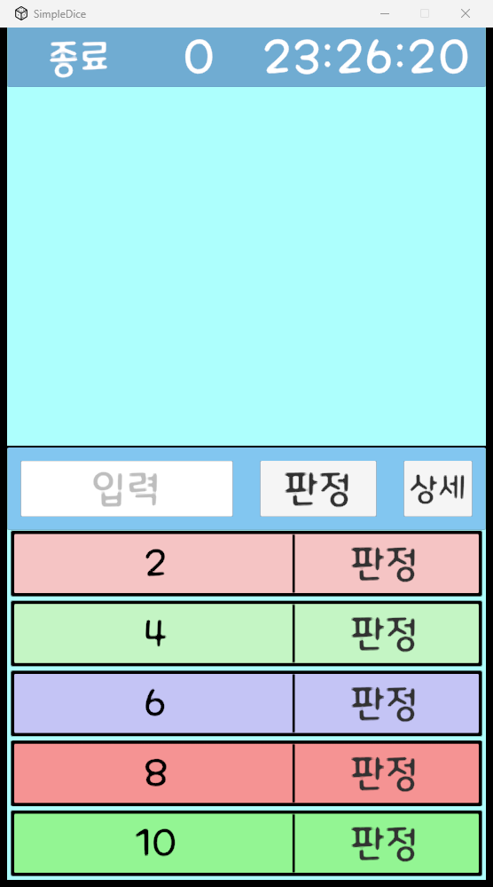

# SimpleDice

간단한 주사위 판정 앱. 2 · 4 · 6 · 8 · 10면체 버튼을 누르거나 원하는 면 수를 입력해 굴리고, 지난 판정 기록을 상세 화면에서 본다.

## 받기

[Releases](../../releases)에서

| 파일 | 대상 |
|---|---|
| `SimpleDice-<버전>-android.apk` | 안드로이드 휴대전화 (처음 설치 시 "출처를 알 수 없는 앱" 허용 필요) |
| `SimpleDice-<버전>-windows.zip` | Windows — 압축을 풀고 `SimpleDice.exe` 실행 |

## 사용 에셋

- 효과음: 공유마당 [1](https://gongu.copyright.or.kr/gongu/wrt/wrt/view.do?wrtSn=13220923&menuNo=200020) · [2](https://gongu.copyright.or.kr/gongu/wrt/wrt/view.do?wrtSn=13073878&menuNo=200020)
- 글꼴: [메이플스토리 서체](https://maplestory.nexon.com/Media/Font)
- 아이콘: [Flaticon — dice](https://www.flaticon.com/kr/free-icon/dice_6356547)

## 문의

버그 · 제안은 [Issues](../../issues)에.
